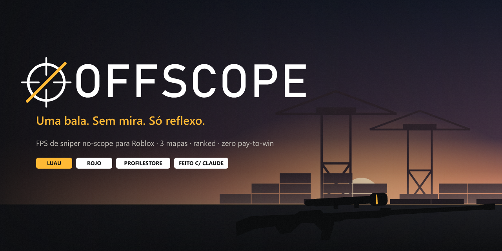
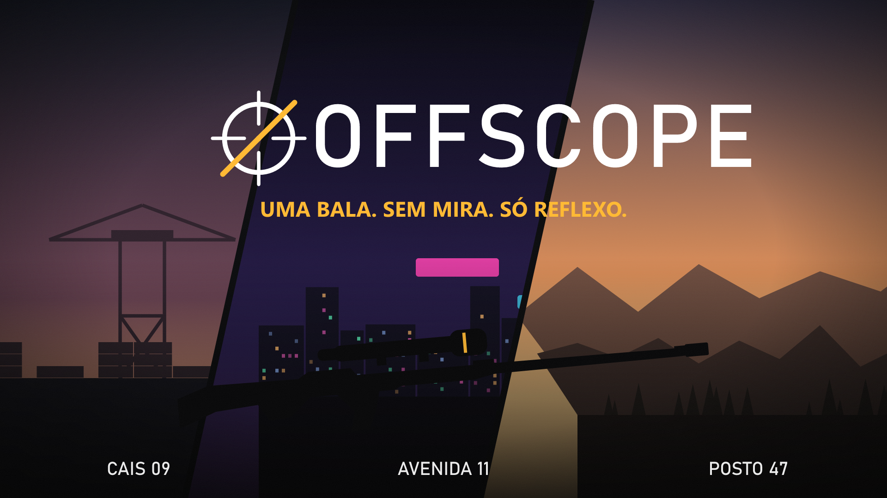
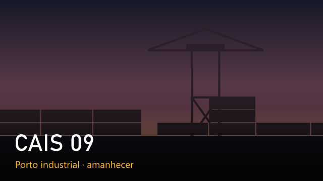
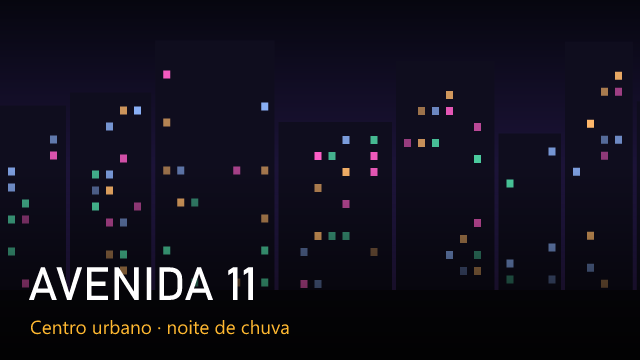
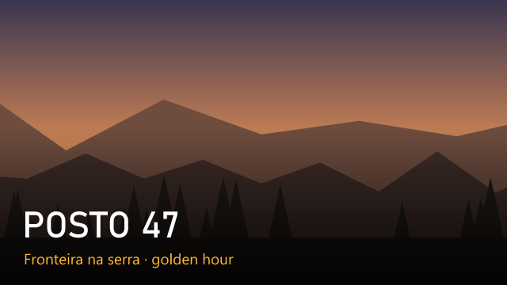
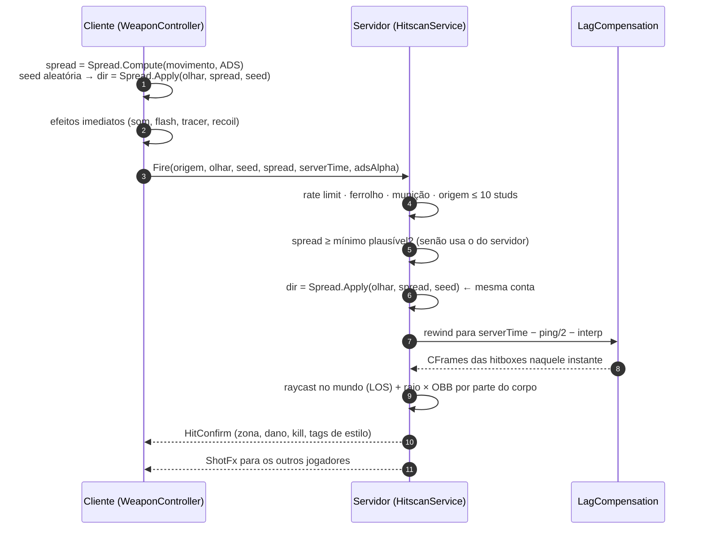

<p align="center">
  
</p>

<p align="center">
  <a href="https://github.com/devrafcks/OFFSCOPE/actions/workflows/ci.yml"></a>
  
  
  
  
  
</p>

**OFFSCOPE** é um FPS online em primeira pessoa para Roblox com **uma sniper, uma faca e três mapas**.
A fantasia é o **no-scope**: o tiro de quadril é o tiro certo, o scope é lento, te deixa mais devagar e
brilha para o inimigo. Partidas curtas, ranked com ELO, cosméticos a preço justo e **zero pay-to-win**.

<p align="center">
  
</p>

---

## Por que este jogo existe

Eu sou dev e queria duas coisas ao mesmo tempo: **um jogo que eu mesmo quisesse jogar com os amigos no Roblox**
e **um projeto que me obrigasse a resolver problemas de engenharia de verdade** fora do meu dia a dia.

Um FPS multiplayer é um ótimo pretexto para isso. Para o no-scope ser justo, o servidor precisa ser a autoridade
do tiro mesmo com 150 ms de ping, o que pede *lag compensation* com rewind de hitboxes. Para os cosméticos
não virarem pay-to-win, a economia tem que ser pensada como produto. E para o jogo ser bonito e leve no celular,
cada luz e cada sombra entram num orçamento.

O projeto foi construído em **pair programming com o [Claude](https://claude.ai) (Claude Code)**. Eu defini a visão,
as regras e as decisões de design; o Claude acelerou a escrita, a pesquisa de APIs e a validação. Foi um exercício de
**como trabalhar bem com uma IA num projeto grande**: escopo claro, decisões documentadas
([`docs/`](docs)), commits pequenos e checagem automática (tipos + lint + build) em todo push.

É um projeto pessoal, feito por diversão e aprendizado, mas tratado com padrão profissional.

---

## Destaques

| | |
|---|---|
| 🎯 **Hitscan autoritativo** | O cliente manda *intenção* (origem, olhar, semente do spread, horário). O servidor reproduz a direção com a **mesma semente determinística**, faz rewind das hitboxes e decide o acerto. |
| ⏪ **Lag compensation** | Histórico de hitboxes a 30 Hz por parte do corpo, interpolado. Rewind limitado a 0,45 s, checagem de linha de visão e raio × OBB próprio (slab method). |
| 🔪 **Faca com backstab** | 1 hit nas costas, 2 na frente. O servidor escolhe o alvo com rewind e compara o olhar rebobinado da vítima. |
| 🗺️ **3 mapas 100% em código** | Porto ao amanhecer, centro urbano à noite e serra na golden hour, com **terreno real via `WriteVoxels`**. Só o mapa da partida é instanciado. |
| 💡 **Visual realista** | `LightingStyle.Realistic`, Atmosphere, Clouds, materiais PBR nativos e preset de luz **por cliente** (lobby e partidas convivem no mesmo servidor). |
| 🔫 **Viewmodel procedural** | Arma, braços e charm montados com Parts. Ferrolho, reload, sway, bob, recoil por mola e inspeção, tudo animado por código. |
| 🏆 **Ranked + ELO** | Duelo 1v1 e Duplas 2v2 ranqueados, K variável, faixas (Recruta → Lenda), soft reset por temporada e leaderboard global. |
| 🛍️ **Economia justa** | Loja diária determinística (igual em todos os servidores, sem DataStore), catálogo fixo, passe com recompensas fixas e **nenhuma caixa**. |
| 💳 **ProcessReceipt à prova de falha** | Idempotente por `PurchaseId` e só confirma depois que o ProfileStore **salvou de verdade**. |
| 🌐 **Matchmaking** | Filas locais (partida no mesmo servidor) ou **MemoryStore cross-server** + servidor reservado + `SafeTeleport`. |
| 🛡️ **Anti-cheat realista** | Rate limit, cadência, munição e origem validadas no servidor, cone de silent-aim, amostragem de velocidade e estatística de HS%. Gera score e log, **sem ban automático por flick**. |
| 🔊 **Assets próprios** | Todos os sons são **sintetizados** em código, e as texturas de camo e a identidade visual também são geradas aqui. Nada de terceiros. |

---

## Os mapas

<table>
  <tr>
    <td></td>
    <td></td>
    <td></td>
  </tr>
  <tr>
    <td><b>Cais 09</b>: pátio de containers com vãos de faca, armazém, guindaste com plataforma de tiro, navio como spawn e <i>a reta do cais</i> como lane longa.</td>
    <td><b>Avenida 11</b>: avenida de 360 studs para no-scope, boca de metrô com túnel por baixo da pista, hall de prédio atravessável e ponte entre telhados.</td>
    <td><b>Posto 47</b>: vale com terreno por heightmap, estrada de terra (a lane mais longa), hangar, bunkers, torres de vigia e pinheiros nas encostas.</td>
  </tr>
</table>

Ao fim de cada partida rola um **voto de 20 s** (2 mapas sorteados + "Aleatório").

## Modos

| Modo | Formato | Vitória | Fila |
|---|---|---|---|
| Duelo 1v1 | rounds, 1 vida | primeiro a 6 | casual + **ranked** |
| Duplas 2v2 | rounds, 1 vida | primeiro a 6 | casual + **ranked** |
| Equipes 4v4 | TDM com respawn | 40 kills ou 8 min | casual |
| Todos contra todos | 8 jogadores | 20 kills | casual |

---

## Como um tiro funciona



Tags de estilo (**NO-SCOPE**, **QUICKSCOPE**, **360**, **AÉREO**, **HEADSHOT**, **LONGA**, **PELAS COSTAS**) rendem
moedas e aparecem no kill feed. **Nunca** alteram dano.

---

## Arquitetura

```
src/
├─ shared/                 ReplicatedStorage.Shared
│  ├─ Config.luau          ← ÚNICO lugar de números, preços e IDs
│  ├─ Remotes.luau · Types.luau · Audio.luau · AssetIds.luau (gerado)
│  ├─ Combat/              Spread (determinístico), Damage, Hitbox (ray×OBB), ShotStyle
│  ├─ Progression/         Elo, Ranks, Levels
│  ├─ Cosmetics/           Catalog, DailyShop, WrapPainter
│  ├─ Models/              SniperBuilder, KnifeBuilder, ArmsBuilder, CharmBuilder
│  └─ Environment/         LightingPresets (por mapa)
├─ server/                 ServerScriptService.Server
│  ├─ Main.server.luau     bootstrap Init → Start (sem framework)
│  ├─ Services/            Data, Hitscan, Melee, LagCompensation, Damage, AntiCheat,
│  │                       Character, Progression, Ranked, Inventory, Monetization,
│  │                       Matchmaking, Round, Map, Lobby, TeleportServiceWrapper
│  ├─ Match/Match.luau     máquina de estados da partida (rounds, respawn, voto)
│  └─ Maps/                MapKit + Lobby, Cais09, Avenida11, Posto47
└─ client/                 StarterPlayerScripts.Client
   ├─ Main.client.luau
   ├─ Controllers/         Input, Camera, Movement, Weapon, Viewmodel, Effects, Hud,
   │                       MatchUi, Menu, Shop, Killcam, Environment, CharacterPose
   └─ UI/Theme.luau        tokens visuais + construtor declarativo de UI
```

Sem Knit (o repositório foi arquivado) e sem roblox-ts. Cada serviço é um módulo com `Init()`/`Start()`, e as dependências
entre eles passam por um `Registry` em tempo de execução, o que evita `require` circular.

📚 Documentação completa: [**GDD**](docs/GDD.md) · [**Arquitetura**](docs/arquitetura.md) · [**Marcos**](docs/marcos.md) · [**Produtos**](docs/produtos.md) · [Pesquisa original](docs/briefing/pesquisa.md)

---

## Rodando localmente

**Pré-requisitos:** Roblox Studio, [Rokit](https://github.com/rojo-rbx/rokit) e o plugin do Rojo no Studio.

```bash
rokit install
```

```bash
wally install
```

```bash
rojo serve
```

No Studio, abra um place vazio, conecte o plugin do Rojo e dê Play. Para testar partidas use
**Test → Clients and Servers → 2 jogadores** (pise no mesmo pad de **Duelo 1v1** com os dois).

- Sem API Services ligada, o ProfileStore usa **mock** automaticamente (nada é salvo, tudo funciona).
- No Studio você recebe moedas de teste (`Config.Studio.BonusCoins`) e as compras em Robux são **simuladas**.
- Quer testar sozinho? `Config.Studio.MinPlayersOverride = 1` inicia a partida com um jogador.
- Para simular lag: *Studio → File → Studio Settings → Network → Incoming Replication Lag*.

### Validação (a mesma do CI)

```bash
./scripts/check.sh
```

Roda `rojo build`, **type-check com luau-lsp** (definições oficiais do Roblox) e **selene**. O CI publica o
`.rbxl` resultante como artefato em cada push.

---

## Assets gerados por código

Nenhum asset de terceiros. Tudo que o jogo usa é gerado neste repositório:

| O quê | Onde | Como |
|---|---|---|
| Arma, faca, braços, charms | `src/shared/Models` | Parts nativas + Motor6D, em runtime |
| Mapas e lobby | `src/server/Maps` | `MapKit` (blocos, containers, postes, pinheiros) + Terrain voxels |
| 22 efeitos sonoros e ambientes | `assets/audio` | síntese em [`tools/assets/audio.mjs`](tools/assets/audio.mjs) |
| Texturas de camo/carbono/colmeia | `assets/textures` | ruído tileável em [`tools/assets/textures.mjs`](tools/assets/textures.mjs) |
| Banner, thumbnail, ícone | `assets/branding` | SVG → PNG em [`tools/branding/render.mjs`](tools/branding/render.mjs) |

Para subir os sons e as texturas para a sua conta e preencher `AssetIds.luau` sozinho
(Open Cloud, com a **sua** chave):

```bash
node tools/assets/upload.mjs
```

Enquanto isso não roda, o jogo usa sons locais do próprio client (`rbxasset://`) e cores sólidas nos wraps.

---

## Monetização (só visual)

| Item | Robux | Moedas |
|---|---:|---:|
| Camo lisa | 49 | 2.500 |
| Camo militar | 99 | 5.000 |
| Wrap estilizada | 199 | 10.000 |
| Wrap animada | 349 | 18.000 |
| Wrap lendária | 499 | 25.000 ou passe |
| Charms, facas, kill effects | 49 a 299 | 2.500 a 15.000 |
| Passe Prime da temporada | 449 | faixa grátis forte |
| Pacote iniciante | 99 | 2 camos + 1 charm |

Nada muda dano, spread, velocidade, munição ou ELO. A lista completa para criar no Dashboard está em [`docs/produtos.md`](docs/produtos.md).

---

## Status

O código está **completo para as 6 fases do plano** e passa no build, no type-check e no lint. O que falta depende
de ação humana:

- [ ] Playtest no Studio com 2+ jogadores e ajuste fino de feel (spread, ADS, recoil) no `Config.luau`
- [ ] Publicar o lobby place e o match place e colar os PlaceIds no Config
- [ ] Criar os Developer Products e colar os IDs ([lista](docs/produtos.md))
- [ ] Rodar o upload dos assets (`tools/assets/upload.mjs`)
- [ ] Content Ratings no Creator Hub e publicar com o ícone e a thumbnail de `assets/branding`

**Próximos passos:** meshes-herói no Blender com `SurfaceAppearance`, animações gravadas em 3ª pessoa,
parties para a fila 2v2 e serialização de tiros com ByteNet.

---

<p align="center">
  Feito por <a href="https://github.com/devrafcks">@devrafcks</a> com <a href="https://claude.ai">Claude</a> · projeto pessoal, sem afiliação com a Roblox Corporation
</p>
